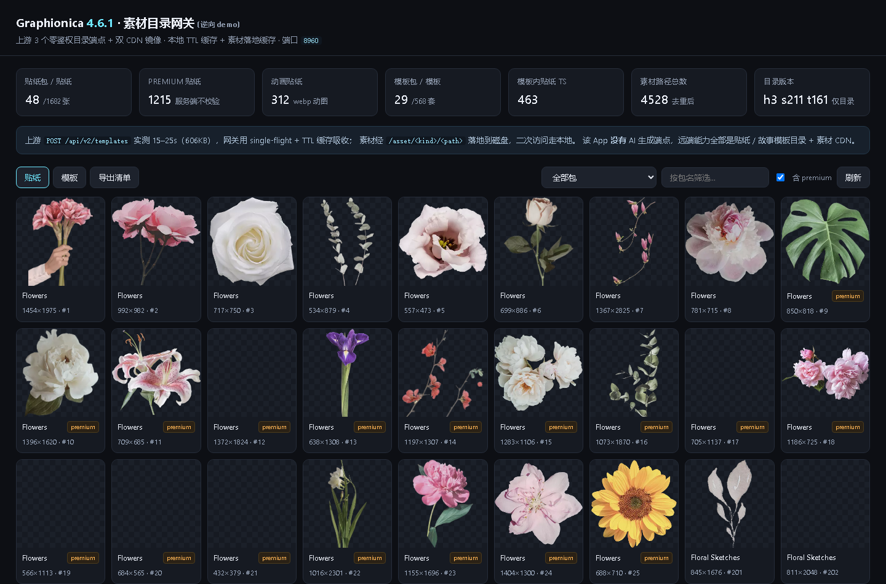
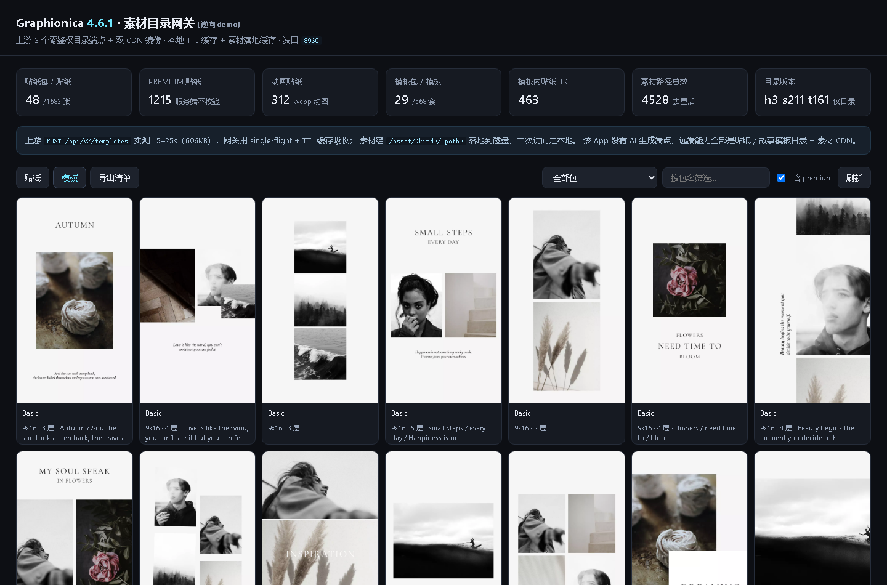
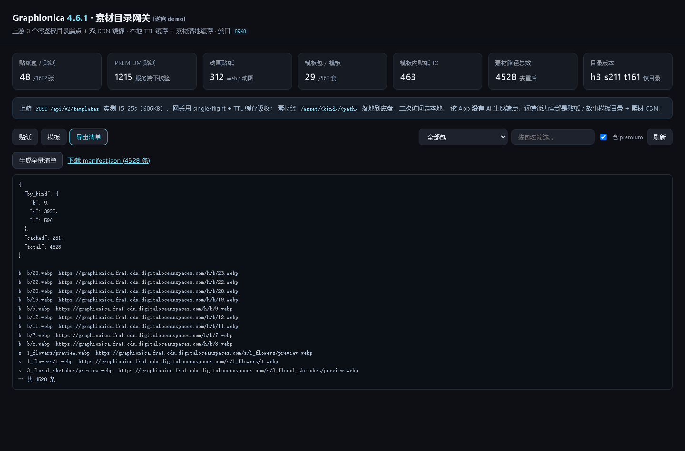

# Graphionica 4.6.1 — 逆向报告 + 素材目录网关

对 `Graphionica_v4_6_1.apk`（`com.graphionica.app`，内部包名 `com.trimf.insta`，versionCode **418**）的
完整静态逆向、远端口径还原、本地网关实现、压测与真实浏览器验证。

> 结论先行：这个 App **没有 AI 生成能力**。它的全部远端接口就是 3 个
> **零鉴权、零签名、零 apikey** 的内容目录端点 + 两条 CDN。真正的可收割资产是
> **1682 张贴纸（1215 张标 premium）+ 568 套故事模板（489 套标 premium）+ 463 个模板内小贴纸**，
> 服务端对 premium 不做任何校验，锁只在客户端（且本 APK 已被 patch 成恒真）。

---

## 1. 指纹与静态事实

| 项 | 值 |
|----|----|
| 包名 / 内部包名 | `com.graphionica.app` / `com.trimf.insta`（开发者 Trimf） |
| 版本 | 4.6.1，versionCode `418`（客户端上报） |
| APK 体积 / dex | 63.9 MB / 2 个 dex（7.05 MB） |
| 加固 / 壳 | 无壳。`pglarmor` 类字符串来自穿山甲广告 SDK，不是加固 |
| 本 APK 是否原版 | **否，MOD 版**。含 `ApkSignatureKillerEx`、`liteapks.com` 字符串，且 premium 判定被改成恒真（见 §4） |
| 技术栈 | Kotlin + RxJava2 + Retrofit2（混淆为 `al.*` / `dl.*`）+ OkHttp3 + Room + Google Play Billing |
| 第三方 SDK | Stipop 贴纸 SDK（`messenger.stipop.io`）、Firebase Analytics/Crashlytics、AdMob、Play Review |

## 2. 逆向路径（可复现）

```text
1. python zipfile 解包 → 只 2 个 dex，无 assets 资源包（assets 仅 dexopt profile）
2. dex 字符串扫描 → 唯一自有域名：graphionica-app.firebaseapp.com、graphionica.fra1.cdn.digitaloceanspaces.com
3. jadx 全量反编译（--no-res）→ 21 MB Java，3401 个类，9 处反编译错误（不影响协议）
4. grep "graphionica-app" → tc/a.java（Retrofit baseUrl 提供者）
5. tc/b.java 是 Retrofit 工厂；消费方 5 处 → uc/e、uc/d、uc/b 是接口定义
6. uc/*.java 里注解保留：@dl.o=POST / @dl.f=GET / @dl.c=@Field / @dl.t=@Query / @dl.e=@FormUrlEncoded
7. 黑盒验证：GET → 404 "Cannot GET /api/v2/home"（Express），改 POST + form → 200 打通
```

混淆映射（本次逆向的关键桥）：`retrofit2` → `al.*`，`retrofit2.http` → `dl.*`，
`Observable` → `ui.j`，Gson → `com.google.gson`（未混淆）。

## 3. 协议全还原（3 个端点）

Base URL：`https://graphionica-app.firebaseapp.com/api/v2/`（Firebase Hosting 前端 → Express 后端）

全部为 **POST + `application/x-www-form-urlencoded`**，**无任何鉴权头**：

| 端点 | form 字段 | 返回 |
|------|-----------|------|
| `POST /api/v2/home` | `version, platform, versionCode, language, country` | 9 个运营 banner + 目录版本 `v=3` |
| `POST /api/v2/stickers` | 同上 | `sP` 48 个贴纸包、`s` 1682 张贴纸，`v=211` |
| `POST /api/v2/templates` | 上面 + `stickersVersion` | `tP` 29 个模板包、`t` 568 套模板、`tS` 463 个模板小贴纸，`v=161` |

统一信封：

```json
{ "u":  "https://graphionica.fra1.cdn.digitaloceanspaces.com/s/",
  "u2": "https://storage.yandexcloud.net/graphionica/s/",
  "v": 211, "isV": true, "sP": [...], "s": [...] }
```

- `u` = 主 CDN 前缀（DigitalOcean Spaces），`u2` = 镜像（Yandex Object Storage）
- **增量语义**：把 `version` 传成服务端当前版本 → `isV=false` + 空数组（客户端靠这个省流量）。
  传 `0` 或不传 → 全量。传更大值（`999999`）→ 仍是全量（服务端只做 `==` 判断）
- 素材 URL = `<u 或 u2>` + item 路径。`tS[].u` 形如 `s/1.webp`，仍然挂在 **templates** 前缀下
  （`.../t/s/1.webp` → 200，已验证；不是 sticker 前缀）
- 部分路径自带 cache-buster：`10_home/preview.webp?v=4`（落盘要剥离 query，见 `asset_key()`）

字段级说明、错误行为、边界探测结果见 [`docs/PROTOCOL.md`](docs/PROTOCOL.md)。

## 4. 鉴权与 premium 真相

- 三个端点**没有任何头部校验**：不带 UA、不带 apikey、不带签名、不带设备 ID 也返回 200
- 服务端**不校验订阅状态**：premium 只是 `s[].isP` / `t[].isP` 两个布尔字段
- 因此 **1215 张 premium 贴纸、489 套 premium 模板的直链对任何人都是公开可下载的**
- 客户端侧（本 MOD 版）premium 闸门被直接改成恒真：

```java
// nh/b.java —— 原版应为 SKU 集合判断，此 APK 被 patch
public final boolean f() { return this.f13626b.size() > 0 ? true : true; }  // isPremium()
public final boolean g() { return c() != null ? true : true; }
public final boolean h() { return d() != null ? true : true; }
```

唯一的真实密钥出现在**第三方 SDK**：`tc/d.java` 给 `messenger.stipop.io` 加
`apikey: <REDACTED>`（Stipop 贴纸搜索 key，只对第三方服务有效，与 Graphionica 目录无关）。

## 5. "有没有 AI" —— 核查过程与结论

| 检查 | 结果 |
|------|------|
| dex 字符串 `openai / gpt-4 / dall / stability / replicate / midjourney` | 0 命中（`dall` 只命中 `addAll`） |
| `removebg / segment / segmentation / matting` | 仅命中 `kotlinx.coroutines.segmentSize` 等无关词 |
| Retrofit 接口全量枚举（`@dl.*` 注解） | 全库只有 4 个接口文件，9 个方法，全部是目录 / 素材 / 第三方贴纸搜索 |
| 隐藏路由探测（`version/settings/config/fonts/purchase/user/health/status/subscribe`） | 全部 404 |
| 编辑器能力 | 全部本地端侧实现（Canvas + WebP 素材 + 字体文件），无云端推理调用 |

**结论：远端攻击面只有"内容目录 + CDN"，不存在生成式能力，也不存在待接的 AI 供应商。**

## 6. 交付物

| 文件 | 作用 |
|------|------|
| `graphionica_client.py` | 协议客户端：3 端点、增量语义、双 CDN 回退、素材下载、`asset_key()` 落盘规范 |
| `demo_server.py` | 本地网关（端口 **8960**）：TTL 缓存 + single-flight、素材代理/落地缓存、目录浏览 API、全量清单 |
| `static/demo.html` | 演示页：贴纸/模板瀑布流、包筛选、premium 标记、图层文字预览、一键导出清单 |
| `stress_test.py` | 本地压测：9 个场景（含 3 个错误路径），输出 p50/p95/p99 与 RPS |
| `benchmark.py` | 上游 vs 网关对比、素材冷/热、并发曲线，产出 `benchmark_results.{json,md}` |
| `harvest.py` | 全量素材收割：断点续传、并发、镜像回退、404 与写盘失败分开统计 |
| `browser_test.py` | Playwright 真实浏览器验证（8 项断言 + 3 张截图） |
| `docs/PROTOCOL.md` | 字段级协议文档 + 边界探测结果 |

### 快速开始

```powershell
cd D:\apk-analysis\graphionica
python demo_server.py                 # 起网关 http://127.0.0.1:8960
python stress_test.py --port 8960 --json stress_results.json
python benchmark.py --port 8960 --rounds 3
python browser_test.py --port 8960
python harvest.py --limit 60          # 小样；去掉 --limit 就是全量
```

网关端点：

```text
GET  /                           演示页
GET  /health  /stats             缓存状态 / 计数器
POST /api/v2/{home,stickers,templates}   原始透传（遵守增量语义）
GET  /catalog/summary            目录统计
GET  /catalog/stickers?page&size&pack&include_premium&q
GET  /catalog/templates?page&size&pack&include_premium
GET  /export/manifest.json       4528 条素材清单（含镜像 URL 与本地缓存状态）
GET  /asset/<kind>/<path>        素材代理（kind = s|t|b），落地磁盘后二次访问走本地
```

## 7. 实测数据（本机，2026 年实测）

压测（`stress_test.py`，全部本机回环，0 失败）：

| 场景 | 并发 | 请求 | RPS | p50 | p95 | p99 |
|------|------|------|-----|-----|-----|-----|
| /health | 16 | 400 | 474 | 32.8ms | 41.8ms | 53.5ms |
| /catalog/summary | 16 | 300 | 266 | 59.6ms | 67.6ms | 70.0ms |
| /catalog/stickers (p1,60) | 8 | 200 | 286 | 28.2ms | 33.0ms | 34.5ms |
| /catalog/templates (p1,24) | 8 | 200 | 295 | 26.4ms | 35.3ms | 39.0ms |
| /api/v2/home 增量 | 16 | 300 | 414 | 37.1ms | 47.0ms | 48.9ms |
| /asset 热命中 | 8 | 120 | 205 | 24.5ms | 225.5ms | 238.2ms |
| 错误路径（400/404） | 4 | 124 | — | 11-12ms | ≤42ms | ≤60ms |

上游 vs 网关（`benchmark.py`，median）：

| 分组 | 场景 | 延迟 |
|------|------|------|
| cache-hit | /catalog/stickers | **5.5ms** |
| cache-hit | /catalog/templates | **5.3ms** |
| cache-hit | /export/manifest.json | 138.7ms |
| asset-cold | 素材首次回源 | 476ms |
| asset-warm | 素材本地磁盘 | 21.5ms |
| upstream | POST /stickers（231KB） | 754.7ms |
| upstream | POST /templates（606KB） | 1161.7ms |
| upstream | CDN 贴纸（203KB） | 1174.2ms |

上游延迟**波动极大**：同一 `/templates` 在不同时段实测 **1.0s ~ 25.5s**（同一天），
`/stickers` 顺序 12 连测 647ms~3764ms，**全程 200、无 429、无限速**。

并发曲线（`/catalog/stickers`，120 请求）：c=1 → 127 RPS，c=4 → 261，c=8 → 264，
c=16 → 201（Flask 单进程 threaded 的天花板，p95 升到 195ms）。

素材收割（`harvest.py --limit 200 --concurrency 8`）：
下载 140 个 / 13.4MB / 28.7s，**0 个 404、0 个失败**。按抽样均值 212KB/张贴纸推算，
全量 4528 条素材约 **450–550MB**，当前 CDN 吞吐下预计 15–30 分钟。

真实浏览器（`browser_test.py`）：**8/8 断言通过** —— 卡片渲染、贴纸/模板出真像素、
模板图层元数据、清单生成、下载链接、缺失素材 404。

| 贴纸浏览 | 模板浏览 | 清单导出 |
|---|---|---|
|  |  |  |

## 8. 本轮交付状态

- **已完成**：协议还原、网关、演示页、压测、基准、浏览器验证、收割工具（抽样 200 条验证 0 失败）
- **未执行（按用户决策）**：全量素材收割（4528 条 / 450–550MB）。工具就绪，随时可跑：
  `python harvest.py --concurrency 8`，中断后可原命令续跑
- **未提供**：任何素材/字体资产本体（版权归 Trimf），仓库只有代码、文档与截图

## 9. 已知限制

1. **Yandex 镜像（`u2`）在国内不通**：`curl` exit 35（SSL connect error）。回退链在境外环境才完整，
   主 CDN 单点可用性等于整体可用性。
2. **上游慢且抖动**：`/templates` 606KB 可能 25s，网关必须缓存；冷启动首次浏览会看到大量占位图。
3. **模板字体不可静态还原**：模板图层里 `fId` 是运行时 `R.font` 资源 ID，不同版本/设备数值不同，
   想复刻模板排版需真机枚举 `fId → fontName` 映射。
4. **素材版权归 Trimf**：本仓库只做协议还原与工具，不含任何图片/字体资产；`assets/`、`cache/` 已 gitignore。
5. Stipop 贴纸搜索 API 需要其 `apikey`（已在源码中脱敏），且只返回 Stipop 自己的库，不属于 Graphionica 目录。

## 10. 边界声明

本项目用于**协议互操作研究**：验证一个公开可访问的内容目录接口是否需要鉴权、增量语义如何工作、
以及本地网关需要怎样的缓存策略才能提供可用的浏览体验。请勿用于再分发受版权保护的素材，
或对上游进行高频压测。
